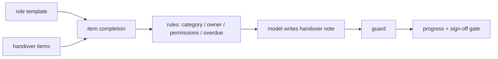

# Baton · handover checklist

[](https://github.com/wushiyi105-jpg/baton/actions)

[](./LICENSE)


Five categories — accounts, documents, clients, code, process — and no signature until permissions are revoked.

## Features

- Checks every item against the five categories and reports anything outside them.
- Reports items with no receiver one by one.
- Refuses `sign` while any account item is still marked as not revoked.
- Lists the first three unfinished items once the handover date has passed.

Rules live in `baton/domain/rules/`; the CLI and the web layer only call them. The Chinese README lists every `rule_id` with its penalty.

## Quickstart

```bash
pip install -e ".[dev]"
python -m baton seed
python -m baton status --iid 1 --day 2026-11-27
python -m baton sign --iid 1 --day 2026-11-27   # 有权限没回收时会被拒
python -m baton serve        # http://127.0.0.1:8009
```

Run `python -m baton --help` for the full command list; `docker build -t baton . && docker run -p 8009:8009 baton` works the same way.

## Why not just ask a general LLM

The usual leak is permissions: documents and clients are handed over, but the back-office sub-account still carries your name. Baton makes revocation a gate on signing instead of a note saying “pending”.

## When to use it

- You leave in two weeks and need to hand everything over.
- You need a hard check that no account still points at you.

## Roadmap

- Push items to the receiver through enterprise IM.
- Sync revocation state from the permission system.

## FAQ

**Why is signing refused?**
At least one account item is not marked revoked.

**Can items belong to another category?**
Only the five categories; anything else is reported.

**Was the Docker image verified?**
Docker is not installed on the build machine, so `docker build .` was not run and the image is unverified; only the Dockerfile and ports were checked statically.

## Commands

See the Chinese README (`README.md`) for the command table with flags; every command supports `--help`.

## Dependencies

FastAPI + Uvicorn, Jinja2, pydantic / pydantic-settings, httpx, Typer + Rich, SQLAlchemy + Alembic; dev extras add pytest, pytest-cov, respx, freezegun, ruff, mypy, pip-audit. Version pinning lives in `uv.lock`.

## How it works



## Layout

```
baton/
├── .github/
│   ├── ISSUE_TEMPLATE
│   ├── PULL_REQUEST_TEMPLATE.md
│   └── workflows
├── assets/
│   └── demo.gif
├── baton/
│   └── … 9 项
├── data/
│   ├── baton.db
│   └── seed.json
├── migrations/
│   ├── __init__.py
│   ├── env.py
│   ├── script.py.mako
│   └── versions
├── prompts/
│   └── handover.md
├── templates/
│   └── index.html
├── tests/
│   ├── __init__.py
│   ├── conftest.py
│   ├── test_access_deadline.py
│   ├── test_engine_sign.py
│   ├── test_items.py
│   └── test_web_cli.py
├── CHANGELOG.md
├── CODE_OF_CONDUCT.md
├── CONTRIBUTING.md
├── Dockerfile
├── LICENSE
├── README.en.md
├── README.md
├── SECURITY.md
├── alembic.ini
├── pyproject.toml
```

## Author

Xiaomi · GitHub [@wushiyi105-jpg](https://github.com/wushiyi105-jpg) · 17612850106
