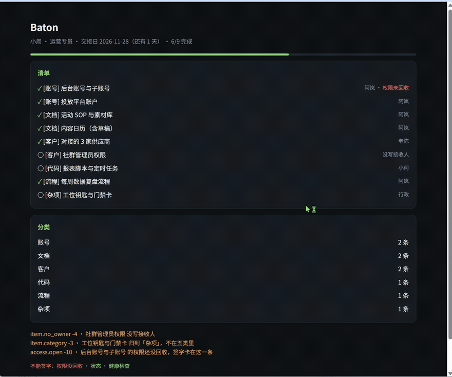

# Baton

[](https://github.com/wushiyi105-jpg/baton/actions)



Handover checklist across five categories, with an access-revocation gate that refuses sign-off.

## Run

```bash
pip install -e ".[dev]"
python -m baton seed
python -m baton status --iid 1
python -m baton serve
```

## Author

shiyi · GitHub [@wushiyi105-jpg](https://github.com/wushiyi105-jpg) · wushiyi105@gmail.com
