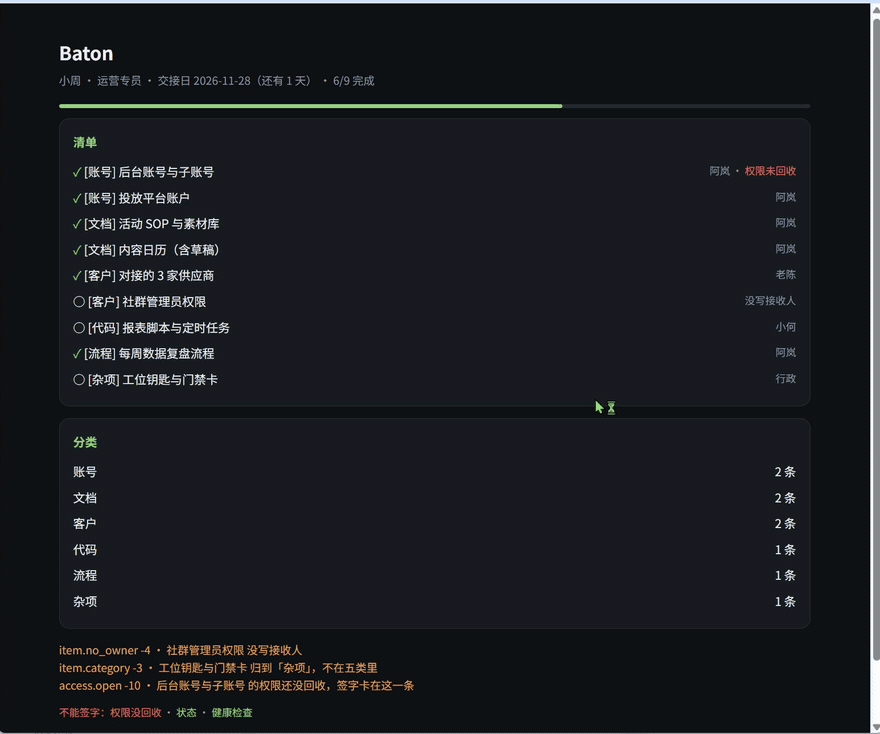
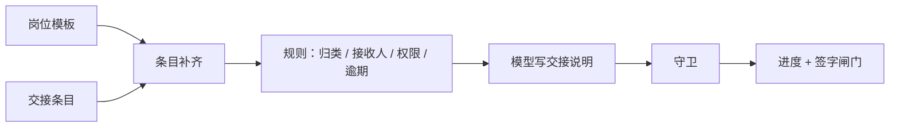

# Baton · 离职交接

[](https://github.com/wushiyi105-jpg/baton/actions)

[](./LICENSE)



交接清单按五类摊开：账号、文档、客户、代码、流程。权限没回收，签字直接被拒。


## 功能特性

1. **五类条目**：账号 / 文档 / 客户 / 代码 / 流程，超出这五类提示归类。
2. **接收人**：空接收人逐条报。
3. **权限闸门**：账号类条目没标回收，`sign` 直接拒绝。
4. **逾期**：交接日过了还有没做完的条目，列前三条。
5. **模板**：按角色一键补齐条目。

### 规则与扣分

| rule_id | 含义 | 扣分 |
| --- | --- | --- |
| `item.category` | 不在五类里 | 3 |
| `item.no_owner` | 没写接收人 | 4 |
| `access.open` | 账号类条目权限未回收（阻塞签字） | 10 |
| `handover.overdue` | 交接日已过且仍有未完成条目 | 6 |

## 快速开始

```bash
pip install -e ".[dev]"
python -m baton seed
python -m baton status --iid 1 --day 2026-11-27
python -m baton sign --iid 1 --day 2026-11-27   # 有权限没回收时会被拒
python -m baton serve        # http://127.0.0.1:8009
```

真实种子：运营专员模板 6 条、1 个交接（小周，交接日 2026-11-28）、9 条条目（6 条已做完）。
以 2026-11-29 跑 `status --iid 1`：6/9（67%），社群管理员权限没写接收人、工位钥匙被归到「杂项」、
后台账号的权限没回收、交接日已过 1 天还有 3 条没做完，合计扣 23 分，结论是不能签字。
`sign --iid 1 --day 2026-11-29` 会以退出码 2 拒绝。

## 为什么不用通用大模型直接问

交接最容易漏的是权限：文档给了、客户给了，后台子账号还挂着你的名字，三个月后出事还是找你。
Baton 把「账号类条目必须标已回收」当成签字闸门——不满足就抛错，而不是在备注里写「待处理」。
另外每条必须有接收人，归不到五类的条目直接报出来。

## 适用场景

- 离职前两周，要把账号、文档、客户、代码、流程逐项交出去。
- 担心后台子账号还挂着自己的名字。
- 交接单要签字，需要一条硬门槛确认权限已回收。

### 边界

- 不接公司 AD，权限回收要自己去后台点；
- 不判断条目是否该交接，只判断有没有漏；
- 不生成离职证明。

## Roadmap

- 接企业 IM 待办，接收人直接收到条目。
- 权限系统 API 对接，回收状态自动回填。
- 按岗位预置模板（运营 / 研发 / 销售）。

## FAQ

**签字被拒怎么办？**
先把账号类条目标成已回收，再签。

**条目可以归到别的类吗？**
只有账号 / 文档 / 客户 / 代码 / 流程五类，其他会报 `item.category`。

**会生成离职证明吗？**
不会。

## 命令参考

| 命令 | 作用 | 常用参数 |
| --- | --- | --- |
| `seed` | 写入模板、交接实例、条目。 | --db |
| `status` | 进度、分类、阻塞。 | --iid, --day, --db |
| `tick` | 把一条标成做完。 | --item, --db |
| `fill` | 按模板补齐条目。 | --iid, --db |
| `note` | 模型写交接说明（无 key 时不编）。 | --iid, --db |
| `sign` | 签字；权限没回收会被拒。 | --iid, --day, --db |
| `doctor` | 四项体检。 | --db |
| `serve` | Web 界面。 | --port, --db |

全部命令都支持 `--help`；只读命令不带参数时读默认库 `data/baton.db`，写命令用 `--db` 指到别的库。

## 依赖说明

| 依赖 | 为什么装 | 不装会怎样 |
| --- | --- | --- |
| `fastapi` + `uvicorn[standard]` | Web 入口与 ASGI 服务 | 只有命令行，没有页面 |
| `jinja2` | 服务端渲染模板 | 页面出不来 |
| `pydantic` + `pydantic-settings` | 配置与数据结构校验，`.env` 直接生效 | 配置散在代码里，改端口要改源码 |
| `httpx` | 调模型与 webhook 的 HTTP 客户端 | 模型层与推送都不可用 |
| `typer` + `rich` | 命令行与终端表格 | 只能用 curl 调接口 |
| `sqlalchemy` + `alembic` | 本地库与迁移 | 表结构变更只能删库重来 |
| `pytest` / `pytest-cov` / `respx` / `freezegun`（dev） | 单测、覆盖率、HTTP 打桩、冻结时间 | 规则改动没有回归保护 |
| `ruff` / `mypy` / `pip-audit`（dev） | 风格、类型、依赖漏洞检查 | CI 只看测试，类型错误会漏进主干 |

装了 `uv` 的话，`uv sync --extra dev` 会按 `uv.lock` 装同一套版本。

## 工作原理




domain 里是分类、接收人、权限闸门与逾期；app 负责进度与签字。

## 目录结构

```
baton/
├── .github/
│   ├── ISSUE_TEMPLATE
│   ├── PULL_REQUEST_TEMPLATE.md
│   └── workflows
├── assets/
│   └── demo.gif
├── baton/
│   └── … 9 项
├── data/
│   ├── baton.db
│   └── seed.json
├── migrations/
│   ├── __init__.py
│   ├── env.py
│   ├── script.py.mako
│   └── versions
├── prompts/
│   └── handover.md
├── templates/
│   └── index.html
├── tests/
│   ├── __init__.py
│   ├── conftest.py
│   ├── test_access_deadline.py
│   ├── test_engine_sign.py
│   ├── test_items.py
│   └── test_web_cli.py
├── CHANGELOG.md
├── CODE_OF_CONDUCT.md
├── CONTRIBUTING.md
├── Dockerfile
├── LICENSE
├── README.en.md
├── README.md
├── SECURITY.md
├── alembic.ini
├── pyproject.toml
```

## 作者

小米 · GitHub [@wushiyi105-jpg](https://github.com/wushiyi105-jpg) · 17612850106
